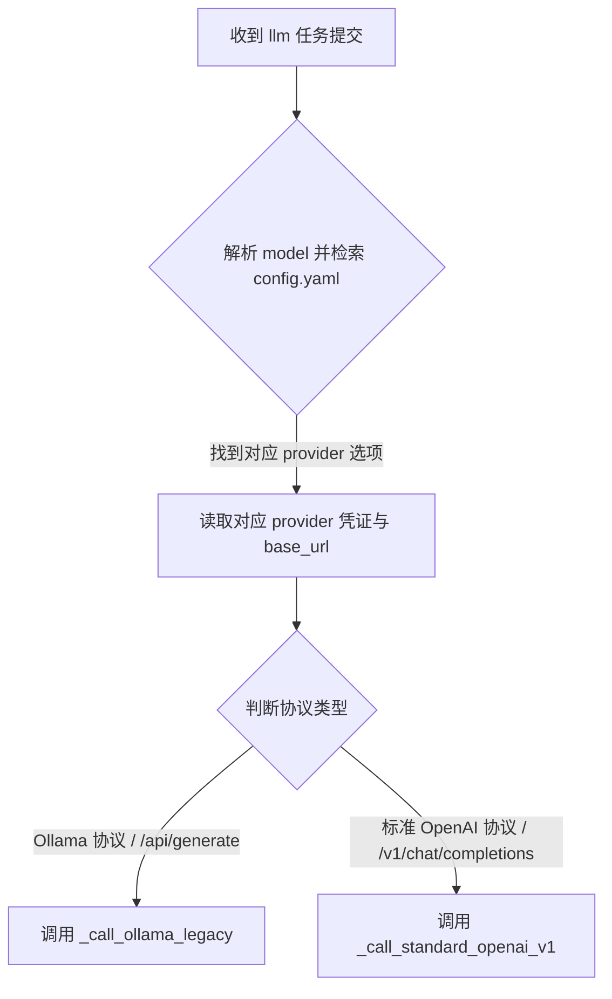

# KamlPro (Kalm) 战略改造与开发任务书 (RENOVATION_PLAN.md)

本文件详尽记录了将 **KamlPro (Kalm)** 升级为 **EchoDrama GUI V3 统一后端控制网关** 的大改造开发任务。通过将所有大模型（含本地与云端 API）、绘图、配音、字幕任务收归网关进行统一调度排队与显存动态管理，客户端与服务端的集成界限将更加清晰。

---

## ── 目录 (Table of Contents) ──
1. [改造核心目标](#1-改造核心目标)
2. [联调方案与独立开发优势](#2-联调方案与独立开发优势)
3. [第一阶段：LLM 智能分发器改造 (executors/llm.py)](#3-第一阶段llm-智能分发器改造-executorsllmpy)
4. [第二阶段：流式输出 NDJSON 透传机制改造](#4-第二阶段流式输出-ndjson-透传机制改造)
5. [第三阶段：GET /models 模型资产接口升级](#5-第三阶段get-models-模型资产接口升级)
6. [测试验证与冒烟测试方案](#6-测试验证与冒烟测试方案)

---

## 1. 改造核心目标
1. **单一 LLM 入口抽象**：PyQt6 客户端无论是调用本地模型还是线上 API（OpenAI, DeepSeek, Gemini），统一请求 KamlPro 的 `/interface/llm/generate` 和 `/generate-stream` 端点。
2. **凭证完全安全物理隔离**：所有的 API 密钥完全配置在服务端的 `config.yaml` 或环境变量中，杜绝客户端的明文 Key 泄漏。
3. **消除重复逻辑代码**：利用本地 Ollama 完全兼容 OpenAI `/v1/chat/completions` 标准接口协议的特性，合并本地与云端大模型的执行器（Executor）调用路径，精简 80% 的网络交互代码。

---

## 2. 联调方案与独立开发优势

> [!NOTE]
> **将改造计划独立编写在 KamlPro 目录下的优势：**
> 1. **清晰的“前后端隔离”边界**：KamlPro 作为纯中转控制站，理应独立开发与独立演进。在 KamlPro 目录中管理任务可避免客户端 UI 代码与其产生物理耦合。
> 2. **杜绝“黑盒式”联调噩梦**：通过在网关下先使用 `test/` 目录的测试脚本（如 `test_comfyui.py`, `test_tts.py`）进行**全自动 Mock 或直接冒烟测试**，确保网关接口 100% 工作无误。
> 3. **极佳的排障隔离性**：如果在联调中发生错误，若网关测试脚本是通过的，说明 Bug 100% 存在于客户端 UI 信号层；若网关测试不通过，则是服务端路由问题。排查效率提升 10 倍。

---

## 2.5 第零阶段：平台自适应、级联配置与配置中心模块化重构 (已完成)

### 2.5.1 改造逻辑
- **OS 级联自适应**：合并 `ComfyUI_Windows`、`ComfyUI_Linux` 为通用 `ComfyUI`，合并 `TTS_Windows`、`TTS_Linux` 为通用 `TTS`。
- **级联覆盖合并机制**：最外层配置默认公共参数，`platforms` 下仅对特定 OS 执行差异化覆盖。`service_controller.py` 加载时全自动深度合并，遵循 DRY 开发原则。
- **构建高内聚 `utils/` 工具库**：抽象独立的 `json_helper.py`（进行 LLM NDJSON 清洗与括号匹配解析）与 `path_helper.py`（进行跨操作系统文件路径与 ComfyUI 流程图 JSON 智能翻译），杜绝 Executors 内部臃肿。
- **配置层极致精简与完全模块化**：将任务定义（`tasks`）、子进程（`services`）、LLM 提供商（`llm_providers` / `llm_config`）与模型/图像后缀过滤（`model_extensions`）解耦出主 `config.yaml`。在 `configs/` 子目录下统一按键值映射（`key: "configs/filename.yaml"`) 进行扁平化声明。配置加载器实现**智能字典拆箱（Smart Unwrapper）**，做到“子文件有 key 具高读写性”与“装载后主配置扁平”的优雅共存。

### 2.5.2 改造清单 (DONE)
- [x] **重载并迁移服务注册表至 [configs/services.yaml](configs/services.yaml)**：全面改为级联默认+特异覆盖架构，并从根目录清理冗余。
- [x] **模块化子配置文件创建**：将大模型注册表、AIGC 常见过滤后缀、服务任务映射关系独立装载到 `configs/` 目录下。
- [x] **极致精简核心映射表 [config.yaml](config.yaml)**：大幅清理主配置膨胀，直接通过直接文件路径进行优雅键值绑定映射。
- [x] **升级解析器 [service_controller.py](src/core/service_controller.py)**：默认读取 `configs/services.yaml`，并提供对根目录 `services.yaml` 的平滑向下兼容。
- [x] **升级加载器 [yaml_config_loader.py](src/logic/yaml_config_loader.py)**：重构并新增递归 `_resolve_sub_configs` 深度字典合并（`_deep_merge`） and 子配置同名键自动拆解展开逻辑。
- [x] **创建 Utils 辅助函数包 [src/utils](src/utils)**：编写完备的 `json_helper.py`、`path_helper.py` 及统一入口 `__init__.py`，修复了 `path_helper.py` 遗留的模块导入 bug，为下阶段 LLM 执行器大升级与路径翻译打下稳健基础。

---

## 3. 第一阶段：LLM 智能分发器改造 (executors/llm.py)

### 3.1 改造逻辑
在 `src/core/executors/llm.py` 中，重构 `execute` 函数。使其不再硬编码调用本地 Ollama 接口，而是进化为智能分发。



### 3.2 任务清单 (TODO)
- [ ] **物理读取配置**：在 `llm.py` 中载入 `llm_providers` 与 `llm_config.models`。
- [ ] **编写统一的云端请求器 `_call_cloud_api()`**：
  - 提取 `provider` 对应的 `base_url` 与 `api_key`。
  - 构造标准的 OpenAI 格式 Body：
    ```json
    {
      "model": "gpt-4o-mini", // 传递给服务端的物理模型名称
      "messages": [{"role": "user", "content": prompt}],
      "temperature": options.get("temperature", 0.15),
      "max_tokens": options.get("max_tokens", 2000)
    }
    ```
  - 支持 **JSON Mode** 透传：如果 payload 中声明了 `response_format`，则将其附加在 API Body 中投递。
- [ ] **返回结果统一格式化**：确保无论本地还是云端，最终写回 `TaskManager` 的数据字典结构绝对一致：
  ```json
  {
    "text": "大模型生成的回复内容",
    "model": "gpt-4o-mini",
    "provider": "openai"
  }
  ```

---

## 4. 第二阶段：流式输出 NDJSON 透传机制改造

### 4.1 改造逻辑
重构 `execute_stream(task_id, output_queue, **payload)` 函数。
- 当调用流式大模型时，通过 `requests.post(..., stream=True)` 或是 `httpx`，逐行获取流式响应（NDJSON）。
- **统一流式数据帧标准**：将不同大模型产出的流式数据，在 Executor 中统一过滤提取出 `response` 字段，以极简标准的 NDJSON 格式推入 `output_queue` 队列。

### 4.2 任务清单 (TODO)
- [ ] **编写统一的流式处理泵 `_stream_cloud_api()`**。
- [ ] 解析云端流式响应中的 `choices[0].delta.content`，包装为本地 Ollama 流式格式：
  ```json
  {"response": "生成的单字/词片段", "done": false}
  ```
- [ ] 监测流式结束帧，当云端输出 `finish_reason` 判定结束时，向队列写入最后一行 `{"done": true}`，并向 `output_queue` 注入 `None` 中止符，通知 FastAPI 网关流式终止。

---

## 5. 第三阶段：GET /models 模型资产接口升级

### 5.1 改造逻辑
在 `src/api/routes/llm.py` 中，重构 `/interface/llm/models` 端点。

### 5.2 任务清单 (TODO)
- [ ] 读取 `config.yaml` 中的 `llm_config.models` 数组。
- [ ] 直接向前端抛出这个格式化的统一注册表 JSON 数组。
- [ ] 支持按 `tier` 或 `provider` 进行自动聚类，支持前端的极简拉取显示。

---

## 6. 测试验证与冒烟测试方案

### 6.1 编写 `test/test_cloud_llm.py`
在 `KamlPro/test/` 目录下编写独立的云端大模型测试脚本，包含：
1. **非流式测试**：提交 `gpt-4o-mini` 任务，验证是否能成功排队并在几秒后通过 `/status` 接口拿回完美的 JSON 字符串。
2. **流式接口测试**：调用 `/interface/llm/generate-stream` 传入 `deepseek-chat`，验证控制台是否能高频闪烁并逐行吐出生成内容。
3. **容错与并发测试**：提交 10 个 `gpt-4o-mini` 任务并发，观察 FIFO 队列是否能平滑串行消费，且保持 `TaskManager` 内存状态的一致性。
