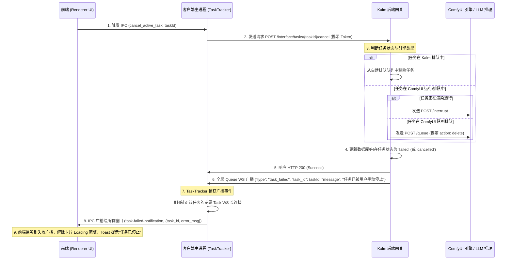

# Kalm 后端任务停止（取消）机制接入规范与流程设计说明

> **文档目的**：供 Kalm 后端开发人员参考，描述客户端（Electron / 前端）与 Kalm 后端在支持“中止/停止 AI 生成任务”功能时的接口契约与后端处理流程设计。

---

## 1. 业务背景与前因后果

在当前的 `comic-verse-editor` 系统中，用户会触发两类长时间运行的 AI 任务：
1. **LLM 任务**（例如：剧本扩写、剧本大纲生成、角色/场景资产提取分析）。
2. **ComfyUI 任务**（例如：分镜画面生图、视频转绘渲染）。

**当前痛点**：
* 目前前端一旦提交任务，界面就会进入“排队中...”或“生成中...”的 Loading 状态蒙版。
* 如果用户发现输入有误（误操作），或者生成时间过长，**目前没有任何中止/撤回该任务的机会**。用户只能死等其成功或超时失败，极大影响了用户体验，且在云端部署环境中造成了不必要的 GPU 算力资源浪费和资金消耗。

因此，我们需要在前端/客户端增加 **“停止/全部停止”** 按钮。这要求 Kalm 后端提供任务主动取消的 API 支持，并配合前端的消息总线完成状态同步。

---

## 2. 整体时序与协作流程 (Sequence Diagram)

当用户点击“停止”时，整体生命周期流转如下：



---

## 3. Kalm 后端开发要求与设计规范

为了实现上述时序，Kalm 后端开发人员需要配合进行如下三方面的开发：

### 3.1 新增取消任务 API 路由
*   **接口地址**：`POST /interface/tasks/{task_id}/cancel` （或 `DELETE /interface/tasks/{task_id}`）
*   **请求头**：同现有的鉴权请求头（例如：`Authorization: Bearer <key>`）
*   **响应格式**：
    ```json
    {
      "status": "success",
      "message": "Task cancellation initiated",
      "data": {
        "task_id": "xxxx-xxxx-xxxx-xxxx"
      }
    }
    ```

### 3.2 实现具体 AI 引擎的中断逻辑

当接收到 `/cancel` 请求时，后端应根据当前任务的 `task_id` 查询其当前所处的物理执行状态：

#### 3.2.1 LLM 推理任务的取消
1.  **排队状态**：若任务正在 Kalm 后端排队，尚未向 LLM 接口发出请求，则直接从内存/Redis 队列中剔除。
2.  **生成状态**：若任务已经在向 LLM 提供商（如 OpenAI, Claude 接口或本地 API）发送请求/流式接收 Token：
    *   **要求**：后端在发起 HTTP 请求时，需要绑定一个超时/取消信号（例如 Node.js/Python 的 `AbortController` 信号，或 Go 语言的 `context`）。
    *   **处理**：触发 Abort，强制断开与大模型底座服务器的 HTTP 长连接，以终止大模型后续 Token 的生成计算与扣费。

#### 3.2.2 ComfyUI 任务的取消
ComfyUI 的任务提交后会生成一个 ComfyUI 的 `prompt_id`，后端需要将 Kalm 的 `task_id` 与 ComfyUI 的 `prompt_id` 进行关联映射。
1.  **ComfyUI 排队中**：
    *   可以通过 ComfyUI 的队列管理接口，从队列中删除指定 `prompt_id`：
    *   **接口**：`POST /queue`
    *   **Payload**：`{ "action": "delete", "delete": [ "<comfy_prompt_id>" ] }`
2.  **ComfyUI 执行渲染中**：
    *   可以通过 ComfyUI 的中断接口强制中断当前渲染进程：
    *   **接口**：`POST /interrupt`
    *   *注*：中断后，ComfyUI 会自动抛出异常并清理显存，释放显卡锁。

### 3.3 任务状态的扭转与 WebSocket 广播同步

任务物理中止后，后端需要将其状态同步给客户端：
1.  **更新数据库/内存状态**：
    *   将该 `task_id` 的任务状态更新为 `failed`（或为取消机制新增一种终态 `cancelled`）。
    *   将 `message` 设为 `"任务已被用户手动停止"` 或者是前端传来的自定义取消原因。
2.  **触发广播事件**：
    *   通过全局队列 WebSocket 频道（`/interface/queue/ws`），向所有在线的客户端广播状态改变事件：
    ```json
    {
      "type": "task_failed",
      "task_id": "xxxx-xxxx-xxxx-xxxx",
      "message": "任务已被用户手动停止"
    }
    ```
    *(注：广播格式和字段命名需对齐现有的 `task_failed` 广播规范，以便 Electron 主进程的 `TaskTracker` 和前端的 `task_recovery.js` 能够零改动直接捕获并完成后续清理逻辑)*。

---

## 4. 总结与交付确认

前端与 Electron 客户端已在此文档的基础上完成了停止按钮的交互开发与接口预埋。当 Kalm 后端完成上述 API 与状态广播的开发并上线后，即可实现前后端无缝对齐的“即时停止”功能。

如有关于接口或时序细节的问题，可随时与客户端团队沟通对接。

---

## 5. 实际落地实现细节说明 (2026-06-20 更新)

后端已经于 2026-06-20 完整实现了上述设计，并进行了以下关键优化和调整：

### 5.1 状态同步与错误信息
* 任务物理中止后，`TaskManager` 中的终态更新为 `"failed"`，错误原因为 `"任务已被用户手动停止"`，与前端完全兼容。
* 成功向全局 WebSocket 队列频道与任务专属频道发出 `task_failed` 消息通知客户端。

### 5.2 各引擎具体物理中断实现
* **ComfyUI 图像引擎**：
  * 引入了 **双重物理中断保障机制**。在 API 路由层（[tasks.py](file:///d:/AIGC/KamlPro/src/api/routes/tasks.py)）接收到取消请求时，会立刻向 ComfyUI 发送 `POST /queue` (delete) 和 `POST /interrupt` 请求；
  * 同时，在 Provider 执行线程（[comfyui.py](file:///d:/AIGC/KamlPro/src/core/providers/image/comfyui.py)）的 WS 监控循环中，一旦检测到任务取消，也会在本地调用 `_delete_from_queue` 和 `_interrupt` 接口，解决并发下的 race condition，确保生图任务 100% 物理掐断。
  * 所有的 POST 中断请求均显式指定了 `method="POST"` 并携带了 JSON 空 payload (`data=b"{}"`) 与 `Content-Type: application/json`，提升了兼容性。
* **LLM 引擎（本地与云端）**：
  * 在流式迭代器（[openai_compatible.py](file:///d:/AIGC/KamlPro/src/core/providers/llm/openai_compatible.py) / [ollama.py](file:///d:/AIGC/KamlPro/src/core/providers/llm/ollama.py)）中检测取消信号，主动 `close` 连接以停止扣费和本地计算开销。
* **TTS 与字幕对齐引擎**：
  * 在状态查询轮询中检测取消信号，主动抛出异常退出，同时向 TTS 服务发送 `POST /cancel/{svc_task_id}` 请求。

### 5.3 错误日志的优雅处理
* 针对用户主动发起的任务中止（`"任务已被用户手动停止"`），在调度器（[scheduler.py](file:///d:/AIGC/KamlPro/src/core/scheduler.py)）和各大执行器（[image.py](file:///d:/AIGC/KamlPro/src/core/executors/image.py), [tts.py](file:///d:/AIGC/KamlPro/src/core/executors/tts.py) 等）的异常捕获中，**屏蔽了冗长的堆栈 Traceback 输出**，改为输出简洁友好的 `log.info` 提示，极大地保持了终端日志的清爽。
