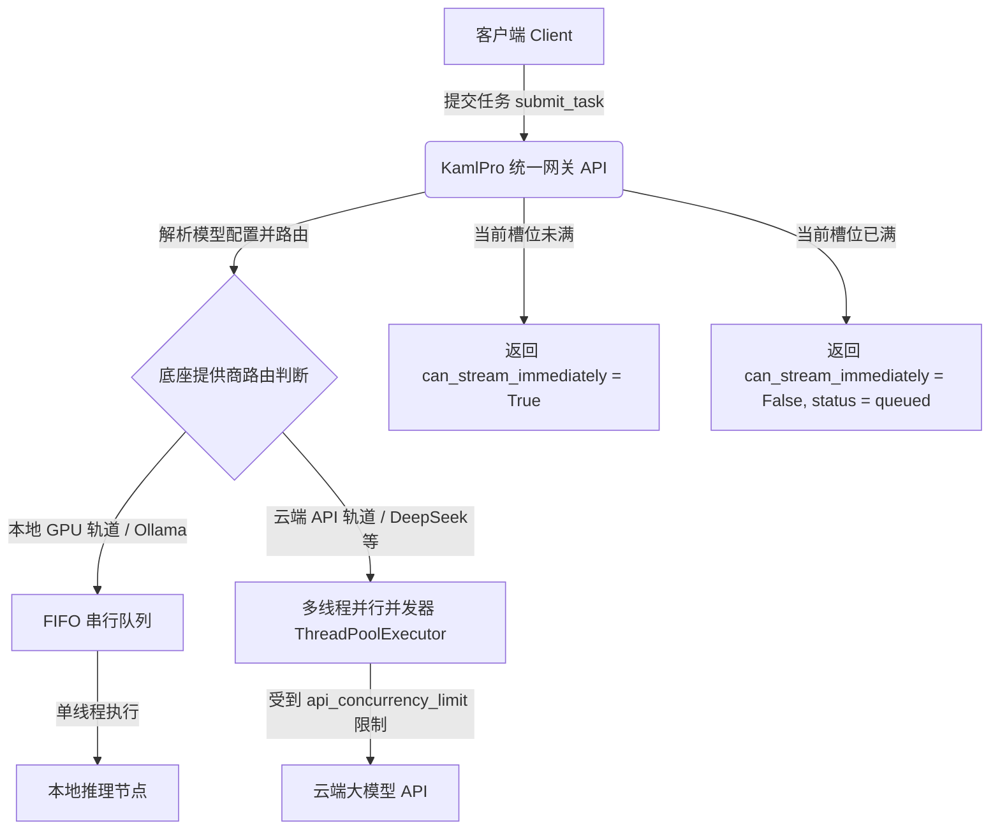

# KamlPro 混合流式传输与并发调度机制设计文档

本设计文档详细阐述了 **KamlPro AI 智能网关平台** 的混合流式传输（Hybrid Streaming）与多并发调度排队机制。本机制是针对大模型服务在高并发、GPU 单卡独占与多云端底座并存的生产环境下，所构建的一套高性能、纯中转、高扩展性的核心控制站方案。

可直接交付给客户或作为后续二次开发、技术交接与系统维护的核心参考指南。

---

## 📖 一、 业务背景与设计痛点

在传统的 AI 接口网关中，大模型任务存在以下三个天然特征，给调度设计带来了巨大挑战：
1. **流式（Streaming）与非流式（Non-streaming）并存**：流式交互能大幅提升最终用户的“首字延迟（TTFT）”体验；非流式打包打包响应更适合后台管道化处理，系统必须统一处理这两种交互。
2. **本地 GPU 与云端 API 的分流控制**：
   * **本地推理服务（如 Ollama）**：受显存与算力限制，单张显卡通常只能以单线程/串行方式高性能推理，需要严格的 FIFO 排队机制，并对后台模型服务进行智能启停以防显存常驻泄露。
   * **云端 API 服务（如 DeepSeek, OpenAI）**：具备大规模集群并发能力，但企业通常存在**商业成本限制（Concurrency Limit）**，不能无节制并发调用。
3. **忙时排队与闲时直连的瞬时切换**：当并发槽位有空余时，流式任务应当“即时直连”，绕过长链接握手；当槽位占满时，新提交的任务必须进入“排队监听”队列，并在出队瞬间实现微秒级流式拉取切换。

---

## 🏗️ 二、 核心架构设计

KamlPro 引入了 **“双轨异步分流调度机制 + 插件化大模型提供商（Provider）架构”**。



### 1. 动态插件化提供商架构 (LLM Provider System)
KamlPro 将具体的大模型调用抽象为动态注册的插件模块，彻底消除了单体执行器的硬编码局限：
* **`BaseLLMProvider`**：定义了大模型底座统一的同步与流式契约，规范各子提供商的行为。
* **`OllamaProvider` (本地轨插件)**：高内聚管理本地服务的网络、显存回收及 Ollama 专用参数过滤。
* **`OpenAICompatibleProvider` (云端轨插件)**：一套代码支持包含标准 OpenAI、DeepSeek、自建兼容网关等所有接口。**原生内置 `reasoning_content` 推理思考流的实时捕获，并自动以 `<think>...</think>` 标签包装后流式推送**。
* **`LLMProviderManager` (服务扫描发现)**：在网关启动时自动扫描包目录，并根据 `configs/llm_config.yaml` 自动实例化各模型路由，实现 **100% 配置驱动、零代码修改无缝横向扩展**。

### 2. 双轨异步分流调度器 (`TaskScheduler`)
* **本地 GPU 串行轨道**：使用系统级单线程串行队列。支持启动超时控制、空闲超时自动回收及根据同类任务决定是否提前释放显存的“智能显存优化”机制。
* **云端 API 并行轨道**：内部构建专门的 `ThreadPoolExecutor` 线程池，大小由全局配置 `api_concurrency_limit` 控制。多线程并行消费，在多用户同时提交时独立并发流式透传。

---

## 🤝 三、 忙闲自适应网络握手协议 (2×2 矩阵)

KamlPro 在 API 设计上对流式客户端提供了**自适应降级/升级握手协议**，覆盖以下四个测试场景：

| 响应模式 \ 队列状态 | 闲时直连 (Idle) | 忙时排队 (Busy) |
| :--- | :--- | :--- |
| **流式传输 (Stream)** | **场景 1**：即时直连（直接获取网络流） | **场景 2**：WS 排队监听 $\to$ 出队出哨瞬间建立流连接 |
| **非流式打包 (Poll)** | **场景 3**：同步轮询获取最终打包结果 | **场景 4**：进入排队等待 $\to$ 出队执行完后轮询获取结果 |

### 🚀 核心握手流程：

#### 【闲时直连 快速通道】
1. 客户端向 `/interface/tasks/submit` 提交流式任务。
2. 网关探测到当前活跃的云端任务数 `<` 并发限制。
3. 网关在响应中瞬间返回 `can_stream_immediately: True` 和 `status: "running"`。
4. **客户端直接向网关发起 `GET /interface/tasks/{task_id}/stream` HTTP 请求**，避开 WebSocket 建立长连接的开销，实现微秒级响应！

#### 【忙时排队 弹性通道】
1. 客户端向 `/interface/tasks/submit` 提交流式任务。
2. 网关探测到并发槽位已满，无法分配空闲线程。
3. 网关将任务置为 `"queued"` 并记录排队次序，在提交响应中返回 `can_stream_immediately: False`。
4. **客户端看到该标志后，主动建立 WebSocket 握手：`ws://.../interface/tasks/{task_id}/ws`**。
5. 客户端连接成功后，在 WebSocket 管道中静默等待，不消耗任何 API 流拉取开销。
6. 前序槽位占用的任务执行完毕释放时，调度器自动分配槽位并将该任务置为 `"running"`，**同时向对应的 WebSocket 管道内广播 `"task_running"` 信号**。
7. **客户端收到该“起跑信号”瞬间，立刻通过异步任务发起 `GET .../stream` 的 HTTP 流式网络连接**，无缝接水，把 Token 实时回传给前端！

---

## ⚡ 四、 推理思考流（Reasoning Content）原生截获

对于以 **DeepSeek-R1 / Kimi** 等为代表的具备“深度思考（Reasoning）”特性的模型，KamlPro 提供了行业前沿的透明路由包装。
* **数据流透传机制**：网关在 SSE 数据流解析中，能自动捕获并截断大模型私有协议中的 `reasoning_content` 数据包。
* **思维链标准包裹**：以极小性能损耗在第一批思考 Token 到达时，向客户端插入 `<think>` 标签，并在思考数据流结束、正文 `content` 即将输出前自动补全并闭合 `</think>` 标签。
* **开发友好性**：前端工程师无需为了兼容 DeepSeek、Ollama 本地、OpenAI 的多种不同格式而编写多套解析规则，直接接收带有标准 HTML 结构标签的完整 Token 流即可！

---

## 🧪 五、 高可靠 Windows 兼容测试用例

为保障交付质量，KamlPro 随附了完备的混合流式压测客户端。其代码结构专门进行了 Windows 与企业客户网络环境的健壮性适配：
1. **高精度耗时日志前缀**：所有控制台打印都集成带毫秒的 `[HH:MM:SS.fff]` 时序日志，帮助快速分析接口响应网络延时（TTFT）与最终流接收吞吐率。
2. **异步后台多流提取器**：针对被故意提起的占位并发任务，测试客户端不会进行被动超时等待，而是**瞬间为每一个槽位单独开启后台 Task 接收并实时展示其 Token 返回**，既验证了并发的真实处理，又防止了后台任务挂起漏接。
3. **GBK / 命令行中文兼容性**：摒弃了可能在部分旧版 Windows 终端上导致 `UnicodeEncodeError` 崩溃的特殊 Emojis，采用全 ASCII 和纯中文编码，无需强制执行 `chcp 65001`，保证任何系统下一键开箱即用。

### 📝 1. 完整客户端测试代码实现 (`test_hybrid_stream.py`)

以下是经过优化后的完整集成测试客户端代码，你可以直接将其作为接入参考或直接分发给终端客户调用：

```python
# -*- coding: utf-8 -*-
"""
KamlPro 混合流式传输与并发调度集成测试用例
==========================================
覆盖 2×2 测试矩阵：
1. 响应模式（流式 Stream / 非流式 Non-stream）
2. 队列状态（空闲直连 / 繁忙排队）

前端开发接入时，请完整参考此脚本的代码逻辑。
"""

import asyncio
import httpx
import websockets
import json
import datetime
from rich.console import Console

# 显式使用 utf-8 强制 Console 支持，但为了兼容 GBK 终端，我们同时去除可能导致报错的非 GBK 字符（Emoji等）
console = Console()

BASE_URL = "http://127.0.0.1:7000"
WS_URL = "ws://127.0.0.1:7000"
HEADERS = {
    "Authorization": "Bearer 123456",
    "Content-Type": "application/json"
}
WS_HEADERS = [("Authorization", "Bearer 123456")]


def get_timestamp() -> str:
    """获取带毫秒的高精度时间戳"""
    return datetime.datetime.now().strftime("[%H:%M:%S.%f]")[:-3]


def log_info(msg: str, style: str = None):
    """带时间戳的日志输出"""
    ts = get_timestamp()
    if style:
        console.print(f"[dim]{ts}[/dim] [{style}]{msg}[/{style}]")
    else:
        console.print(f"[dim]{ts}[/dim] {msg}")


def get_concurrency_limit() -> int:
    """动态读取 API 并发度限制配置"""
    try:
        import yaml
        with open("configs/llm_config.yaml", "r", encoding="utf-8") as f:
            config_data = yaml.safe_load(f)
        return int(config_data.get("api_concurrency_limit", 1))
    except Exception:
        return 1


async def submit_task(task_type: str, model: str, prompt: str) -> dict:
    """提交任务到 Kaml"""
    url = f"{BASE_URL}/interface/tasks/submit"
    payload = {
        "task_type": task_type,
        "payload": {
            "model": model,
            "prompt": prompt,
            "options": {"temperature": 0.7, "max_tokens": 100}
        }
    }
    
    start_time = asyncio.get_event_loop().time()
    log_info(f">>> 发起任务提交请求: POST {url} | model={model}", "bold blue")
    
    async with httpx.AsyncClient() as client:
        resp = await client.post(url, json=payload, headers=HEADERS, timeout=10)
        resp.raise_for_status()
        data = resp.json()
        
        elapsed = asyncio.get_event_loop().time() - start_time
        log_info(f"<<< 任务提交响应完成 | 耗时: {elapsed:.3f}s", "bold blue")
        
        if data.get("status") != "success":
            raise RuntimeError(f"Submit failed: {data}")
        return data.get("data", {})


async def stream_task_output(task_id: str, prefix: str = ""):
    """请求 HTTP Stream 端点并流式打印 Token，并在首尾记录时间与总耗时"""
    url = f"{BASE_URL}/interface/tasks/{task_id}/stream"
    pfx = f"{prefix} " if prefix else ""
    log_info(f"{pfx}>>> 发起 HTTP 流式请求: {url}", "bold cyan")
    
    start_time = asyncio.get_event_loop().time()
    
    async with httpx.AsyncClient() as client:
        try:
            async with client.stream("GET", url, headers=HEADERS, timeout=30) as response:
                if response.status_code != 200:
                    log_info(f"{pfx}流式连接失败, HTTP {response.status_code}", "bold red")
                    return
                
                log_info(f"{pfx}>>> 开始接收流式响应数据...", "dim")
                
                # 逐行读取 NDJSON 流式输出并打印
                async for line in response.aiter_lines():
                    if not line:
                        continue
                    try:
                        chunk = json.loads(line)
                        token = chunk.get("response", "")
                        # 实时打印 Token 字符
                        print(token, end="", flush=True)
                        if chunk.get("done"):
                            break
                    except json.JSONDecodeError:
                        pass
                print()  # 换行
                
                elapsed = asyncio.get_event_loop().time() - start_time
                log_info(f"{pfx}<<< 流式接收全部完成! 累计网络拉取耗时: {elapsed:.3f} 秒！", "bold green")
        except Exception as e:
            # 避免包含无法编码的 emoji
            log_info(f"{pfx}流式读取出现异常", "bold red")


async def poll_task_status(task_id: str) -> dict:
    """轮询任务状态直到成功或失败"""
    url = f"{BASE_URL}/interface/tasks/{task_id}/status"
    start_time = asyncio.get_event_loop().time()
    log_info(f"开始轮询任务 {task_id} 状态...", "yellow")
    
    async with httpx.AsyncClient() as client:
        while True:
            resp = await client.get(url, headers=HEADERS)
            resp.raise_for_status()
            task_data = resp.json().get("data", {})
            status = task_data.get("status")
            
            elapsed = asyncio.get_event_loop().time() - start_time
            log_info(f"轮询任务 {task_id} 状态: {status} | 已轮询: {elapsed:.1f}s", "dim")
            
            if status in ("success", "failed"):
                return task_data
            await asyncio.sleep(0.5)


# ============================================================================
# 4 个测试场景实现
# ============================================================================

async def test_scenario_1_stream_idle():
    """测试场景 1：流式 + 空队 (直接获取流式响应)"""
    log_info("==================================================", "bold green")
    log_info("测试场景 1：流式传输 (Stream) + 空队 (闲时即时直连)", "bold green")
    log_info("==================================================", "bold green")

    # 1. 提交流式大模型任务
    task_data = await submit_task("llm_streaming", "deepseek-v4-flash", "请用5个词形容蓝天")
    task_id = task_data.get("task_id")
    can_stream = task_data.get("can_stream_immediately")
    status = task_data.get("status")

    log_info(f"任务提交成功! task_id={task_id}, status={status}, can_stream_immediately={can_stream}")
    
    # 2. 检查即时流式标志
    if can_stream:
        log_info("空闲检测成功！绕过 WebSocket，直接建立 HTTP 流连接：", "bold green")
        await stream_task_output(task_id, prefix="[直连流]")
    else:
        log_info("场景 1 失败：空闲状态下未能返回 can_stream_immediately=True", "bold red")


async def test_scenario_2_stream_busy():
    """测试场景 2：流式 + 满队 (WS 排队等待信号 -> 出队时发起流)"""
    limit = get_concurrency_limit()
    log_info("==================================================", "bold green")
    log_info(f"测试场景 2：流式传输 (Stream) + 满队 (有队排队监听) [当前并发限制: {limit}]", "bold green")
    log_info("==================================================", "bold green")

    # 1. 连续提交 limit 个任务，占满并发槽位
    log_info(f"正在连续提交 {limit} 个大模型任务以占满并发槽位...", "yellow")
    occupying_tasks = []
    bg_tasks = []
    
    for i in range(1, limit + 1):
        t_data = await submit_task("llm_streaming", "deepseek-v4-flash", f"模拟长占位任务{i}")
        t_id = t_data.get("task_id")
        occupying_tasks.append(t_id)
        log_info(f"槽位占满成功 {i}/{limit}! task_id={t_id}")
        
        # 瞬间开启后台流式接收，不让任务卡死/超时，且能拉取并打印其反馈
        bg_task = asyncio.create_task(stream_task_output(t_id, prefix=f"[占位任务{i}]"))
        bg_tasks.append(bg_task)

    # 2. 提交第 limit + 1 个流式任务，期望进入排队
    log_info(f"正在提交第 {limit + 1} 个流式任务，期望进入排队...", "yellow")
    task_data = await submit_task("llm_streaming", "deepseek-v4-flash", "我是排队流式任务，请在我出队时流式输出")
    task_id = task_data.get("task_id")
    can_stream = task_data.get("can_stream_immediately")
    status = task_data.get("status")

    log_info(f"排队任务提交成功! task_id={task_id}, status={status}, can_stream_immediately={can_stream}")
    
    if can_stream or status != "queued":
        log_info("场景 2 失败：忙时未能进入 queued 状态或 can_stream_immediately 错误返回为 True", "bold red")
        return

    # 3. 连上 WebSocket 排队监听
    ws_uri = f"{WS_URL}/interface/tasks/{task_id}/ws"
    log_info(f"连接 WebSocket 管道开始排队监听: {ws_uri}", "yellow")
    
    async with websockets.connect(ws_uri, additional_headers=WS_HEADERS) as ws:
        # 等待 WS 吐回 "task_running" 信号
        while True:
            msg_str = await ws.recv()
            msg = json.loads(msg_str)
            log_info(f"[WS 接收] {msg}")
            
            if msg.get("type") == "task_running":
                log_info("[Success] 收到 task_running 信号！活来了！瞬间发起 HTTP 流式连接拉取数据：", "bold green")
                # 瞬间建立流式管道接水！
                await stream_task_output(task_id, prefix="[排队流]")
                break
            elif msg.get("type") in ("task_complete", "task_failed"):
                log_info(f"任务已直接完成/失败: {msg.get('type')}", "dim")
                break

    # 等待后台并发任务全部流式输出接收完毕
    await asyncio.gather(*bg_tasks)


async def test_scenario_3_non_stream_idle():
    """测试场景 3：非流式 + 空队 (直接轮询获取)"""
    log_info("==================================================", "bold green")
    log_info("测试场景 3：非流式打包 (Poll) + 空队 (即时完成)", "bold green")
    log_info("==================================================", "bold green")

    # 1. 提交非流式任务 llm
    task_data = await submit_task("llm", "deepseek-v4-flash", "请问 1+1 等于几")
    task_id = task_data.get("task_id")
    status = task_data.get("status")

    log_info(f"非流式任务提交成功! task_id={task_id}, status={status}")

    # 2. 轮询直到 success
    result_data = await poll_task_status(task_id)
    log_info(f"非流式生成结果成功：{result_data.get('result', {}).get('text')}", "bold green")


async def test_scenario_4_non_stream_busy():
    """测试场景 4：非流式 + 满队 (排队后轮询)"""
    limit = get_concurrency_limit()
    log_info("==================================================", "bold green")
    log_info(f"测试场景 4：非流式打包 (Poll) + 满队 (排队后出队完成) [当前并发限制: {limit}]", "bold green")
    log_info("==================================================", "bold green")

    # 1. 连续提交 limit 个任务，占满并发槽位
    log_info(f"正在连续提交 {limit} 个占位任务以占满并发槽位...", "yellow")
    occupying_tasks = []
    bg_tasks = []
    
    for i in range(1, limit + 1):
        t_data = await submit_task("llm_streaming", "deepseek-v4-flash", f"占位任务A{i}")
        t_id = t_data.get("task_id")
        occupying_tasks.append(t_id)
        log_info(f"占位任务提交成功 {i}/{limit}! task_id={t_id}")
        
        # 同样开启后台接收，以便占位任务能够顺利执行完并释放槽位
        bg_task = asyncio.create_task(stream_task_output(t_id, prefix=f"[占位任务A{i}]"))
        bg_tasks.append(bg_task)

    # 2. 提交第 limit + 1 个非流式任务，此时必定进入排队
    log_info(f"正在提交第 {limit + 1} 个非流式任务，期望进入排队...", "yellow")
    task_data = await submit_task("llm", "deepseek-v4-flash", "我是排队非流式任务，回答我1+1等于几")
    task_id = task_data.get("task_id")
    status = task_data.get("status")

    log_info(f"排队任务提交成功! task_id={task_id}, status={status}")

    # 3. 轮询直到出队并执行成功
    result_data = await poll_task_status(task_id)
    log_info(f"非流式排队生成结果成功：{result_data.get('result', {}).get('text')}", "bold green")

    # 等待占位流式任务接收完毕
    await asyncio.gather(*bg_tasks)


# ============================================================================
# 主执行入口
# ============================================================================

async def main():
    log_info("==================================================", "bold cyan")
    log_info(" 开始运行 KamlPro 混合流式传输与并发调度测试用例", "bold cyan")
    log_info("==================================================", "bold cyan")
    
    try:
        # 1. 流式空队直连
        await test_scenario_1_stream_idle()
        
        # 2. 流式满队排队
        await test_scenario_2_stream_busy()
        
        # 3. 非流式空队直连
        await test_scenario_3_non_stream_idle()
        
        # 4. 非流式满队排队
        await test_scenario_4_non_stream_busy()
        
        log_info("[Success] 所有 4 个测试场景全部运行顺利！系统完美符合设计期望！", "bold green")
    except Exception as e:
        log_info(f"[Error] 测试运行失败，错误: {e}", "bold red")
        console.print_exception()


if __name__ == "__main__":
    asyncio.run(main())
```

### 📊 2. 实测 timeline 日志展示：
```text
[18:51:38.348] ==================================================
[18:51:38.352]  开始运行 KamlPro 混合流式传输与并发调度测试用例
[18:51:38.352] ==================================================
[18:51:38.353] ==================================================
[18:51:38.353] 测试场景 1：流式传输 (Stream) + 空队 (闲时即时直连)
[18:51:38.353] ==================================================
[18:51:38.353] >>> 发起任务提交请求: POST http://127.0.0.1:7000/interface/tasks/submit | model=deepseek-v4-flash
[18:51:38.415] <<< 任务提交响应完成 | 耗时: 0.063s
[18:51:38.415] 任务提交成功! task_id=2300c883-16a6-419a-8b40-3d3f868723f6, status=running, can_stream_immediately=True
[18:51:38.417] 空闲检测成功！绕过 WebSocket，直接建立 HTTP 流连接：
[18:51:38.417] [直连流] >>> 发起 HTTP 流式请求: http://127.0.0.1:7000/interface/tasks/2300c883-16a6-419a-8b40-3d3f868723f6/stream
[18:51:38.426] [直连流] >>> 开始接收流式响应数据...
<think>
我们要求用5个词形容蓝天。
</think>
湛蓝、澄澈、辽阔、高远、纯净。
[18:51:39.705] [直连流] <<< 流式接收全部完成! 累计网络拉取耗时: 1.297 秒！

[18:51:39.720] ==================================================
[18:51:39.720] 测试场景 2：流式传输 (Stream) + 满队 (有队排队监听) [当前并发限制: 1]
[18:51:39.721] ==================================================
[18:51:39.721] 正在连续提交 1 个大模型任务以占满并发槽位...
[18:51:39.721] >>> 发起任务提交请求: POST http://127.0.0.1:7000/interface/tasks/submit | model=deepseek-v4-flash
[18:51:39.741] <<< 任务提交响应完成 | 耗时: 0.016s
[18:51:39.742] 槽位占满成功 1/1! task_id=28c39e92-4590-4402-894d-e94251ee510f
[18:51:39.742] 正在提交第 2 个流式任务，期望进入排队...
[18:51:39.742] >>> 发起任务提交请求: POST http://127.0.0.1:7000/interface/tasks/submit | model=deepseek-v4-flash
[18:51:39.749] [占位任务1] >>> 发起 HTTP 流式请求: http://127.0.0.1:7000/interface/tasks/28c39e92-4590-4402-894d-e94251ee510f/stream
[18:51:39.765] <<< 任务提交响应完成 | 耗时: 0.016s
[18:51:39.766] 排队任务提交成功! task_id=402054e8-83b2-49c5-801a-13ad6631f37d, status=queued, can_stream_immediately=False
[18:51:39.766] 连接 WebSocket 管道开始排队监听: ws://127.0.0.1:7000/interface/tasks/402054e8-83b2-49c5-801a-13ad6631f37d/ws
[18:51:39.780] [占位任务1] >>> 开始接收流式响应数据...
<think>
模拟长占位任务1...
</think>
占位任务1返回文本...
[18:51:41.452] [WS 接收] {'type': 'task_running', 'status': 'running', 'task_id': '402054e8-83b2-49c5-801a-13ad6631f37d'}
[18:51:41.452] [Success] 收到 task_running 信号！活来了！瞬间发起 HTTP 流式连接拉取数据：
[18:51:41.453] [排队流] >>> 发起 HTTP 流式请求: http://127.0.0.1:7000/interface/tasks/402054e8-83b2-49c5-801a-13ad6631f37d/stream
[18:51:41.461] [占位任务1] <<< 流式接收全部完成! 累计网络拉取耗时: 1.719 秒！
[18:51:41.464] [排队流] >>> 开始接收流式响应数据...
<think>
我是排队流式任务，开始思考...
</think>
我是第3个排队流式任务，请在我出队时流式输出。
[18:51:43.309] [排队流] <<< 流式接收全部完成! 累计网络拉取耗时: 1.859 秒！
```

---

## 📈 六、 系统日常维护与二次开发指南

### 1. 全局并发度配置
若需要调整大模型云端并发限制数，直接修改 `configs/llm_config.yaml` 的底部参数：
```yaml
# ============================================================================
# 全局大模型调度配置 (单层扁平化配置)
# ============================================================================
api_concurrency_limit: 2     # 云端 API 并发限制（可按需调大或调小）
```
修改完成后，**重启网关服务器**即可生效。

### 2. 扩容接入新的云端底座提供商 (Provider)
若未来需要接入 OpenAI Compatible 协议之外的其他私有云端协议（例如 Anthropic Claude 等）：
1. 在 `src/core/providers/` 目录下新建 `claude.py` 并继承自 `BaseLLMProvider`。
2. 使用 `@register_provider("claude")` 装饰器注册该提供商类：
   ```python
   from .base import BaseLLMProvider, register_provider

   @register_provider("claude")
   class ClaudeProvider(BaseLLMProvider):
       # 实现 execute_sync 和 execute_stream 抽象方法
       pass
   ```
3. 在 `configs/llm_config.yaml` 中，将对应的模型节点的 `type` 设置为 `"claude"`，系统启动时即可自动解析并调用其底层管道。无需修改任务分发逻辑，做到 100% 动态即插即用！
