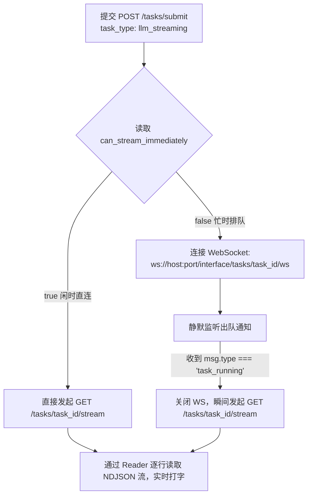

# KamlPro 大语言模型 (LLM) 下游接入与调用全指南

> **适用对象**：前端工程师、后端研发人员、工作流编排开发者  
> **更新日期**：2026-10-07  
> **版本**：v2.0（全平台统一双轨流式与非流式规范）

---

## 🚀 核心接入优势（必读）

1. **接口彻底大一统**：无论您使用的是**本地离线模型**（Ollama 推理）还是**云端在线模型**（DeepSeek、Gemini 等），**接口 URL、入参结构、响应协议 100% 完全一致**！下游调用方无需关心模型究竟部署在哪里。
2. **双模式全支持**：
   * **一次性整段返回 (`task_type: "llm"`)**：适合后台数据提取、自动化 Pipeline、无需打字机的业务；
   * **逐字打字机流式 (`task_type: "llm_streaming"`)**：适合交互式 Chatbot，首字延迟（TTFT）低至毫秒级。
3. **显存安全与自适应排队**：系统底层具备智能 GPU 锁与并发控制。当本地显卡正在画图（ComfyUI）或推理时，新任务自动排队并提供实时出队通知，绝不发生 OOM 显存撞车。

---

## 📋 一、 可用大模型清单速查

在调用 API 时，将 `payload.model` 填入下表中的对应英文名称即可：

| 归属分类 | 模型调用名 (`model`) | 显示名称 | 推荐业务场景 |
| :--- | :--- | :--- | :--- |
| **本地 GPU** | `qwen3:14b` | 通义千问 3 (本地 / 14B) | 本地离线高精度对话、中文处理 |
| **本地 GPU** | `gemma3:12b` | Gemma 3 (本地 / 12B) | 本地轻量化逻辑推理、文本处理 |
| **云端 API** | `deepseek-v4-flash` | DeepSeek V4 Flash (极速) | 极速响应问答、大规模用户交互 |
| **云端 API** | `deepseek-v4-pro` | DeepSeek V4 Pro (高保真) | 复杂逻辑分析、高精度文本生成 |
| **网络代理** | `gemini-3-flash` | Gemini 3 Flash (极速) | 快速多任务问答、翻译 |
| **网络代理** | `gemini-3-pro` | Gemini 3 Pro (高保真) | 复杂长文本生成与总结 |
| **网络代理** | `gemini-3-flash-thinking` | Gemini 3 Flash Thinking (深度思考) | 带有长思维链推理的数学/代码任务 |

---

## 🛠️ 二、 API 接口全量规范

### 1. 提交 LLM 任务 (统一入口)
所有大模型任务统一由此端点发起。

* **请求方式**：`POST`
* **请求路径**：`/interface/tasks/submit`
* **Content-Type**：`application/json`

#### 请求体参数 (Payload)：
```json
{
  "task_type": "llm_streaming",   // "llm_streaming" (流式) 或 "llm" (一次性)
  "payload": {
    "model": "qwen3:14b",         // 目标模型名称（见模型清单）
    "prompt": "请用简练的语言解释什么是量子退火？", // 提示词
    "options": {                  // 可选大模型高级参数
      "temperature": 0.7,
      "max_tokens": 1024
    }
  }
}
```

#### 响应体 (Response)：
```json
{
  "code": 200,
  "message": "success",
  "data": {
    "task_id": "c7a82b41-9876-4d21-a123-bc4e89f71234",
    "status": "running",              // "running" (执行中) 或 "queued" (排队中)
    "track_mode": "stream",           // 流式为 "stream"，一次性为 "ws"
    "can_stream_immediately": true,   // 【流式核心标志】：是否可免等待直接拉流
    "hint": "Streaming response is already in progress via NDJSON"
  }
}
```

---

### 2. 拉取流式输出 (仅用于 `llm_streaming`)
当任务为 `llm_streaming` 时，通过此接口读取实时数据流。

* **请求方式**：`GET`
* **请求路径**：`/interface/tasks/{task_id}/stream`
* **响应格式**：`application/x-ndjson`（换行分隔的 JSON 字符串流）

#### 数据帧规范说明：
每收到一行（以 `\n` 结尾），解析该行的 JSON：
```json
{"response": "量子", "done": false}
{"response": "退火", "done": false}
{"response": "是一种优化算法。", "done": false}
{"response": "", "done": true}
```
* `response` (string)：当前输出的增量 Token 文本。
* `done` (boolean)：当为 `true` 时，表示大模型已生成完毕，通道即将关闭。

> 💡 **深度思考模型说明**：  
> 若调用了带推理链的模型（如 DeepSeek-R1 或 Gemini Thinking），流中会自动包含 `<think>\n` 和 `\n</think>\n\n` 标签。前端只需直接检测标签即可做“展开/收起深度思考过程”的折叠卡片。

---

### 3. 获取任务状态与结果 (用于 `llm` 轮询)
* **请求方式**：`GET`
* **请求路径**：`/interface/tasks/{task_id}/status`
* **响应体示例**：
```json
{
  "code": 200,
  "message": "success",
  "data": {
    "task_id": "c7a82b41-9876-4d21-a123-bc4e89f71234",
    "status": "success",              // "queued" | "running" | "success" | "failed"
    "result": {
      "text": "量子退火是一种利用量子涨落特性寻找函数全局最优解的计算技术...",
      "model": "qwen3:14b",
      "total_duration": 3450000000
    }
  }
}
```

---

### 4. 任务手动取消 / 打断
若用户在生成中途点击“停止”，请务必调用此接口，后端会**秒级掐断本地显卡推理或云端连接**，避免浪费算力。

* **请求方式**：`POST`
* **请求路径**：`/interface/tasks/{task_id}/cancel`

---

## 💡 三、 核心交互套路：2×2 忙闲自适应机制

对于 **流式输出 (`llm_streaming`)**，前端需根据提交任务返回的 `can_stream_immediately` 执行相应握手：



---

## 💻 四、 开箱即用代码范式

### 1. 前端 JavaScript / TypeScript（自适应流式全功能实现）
此函数集成了**闲时直连**、**忙时 WS 排队换流**、**防粘包分行**与**用户主动打断**。前端可直接复制使用：

```javascript
/**
 * 完整 LLM 流式消费函数
 * @param {string} model 模型名称 (如 'qwen3:14b', 'deepseek-v4-flash')
 * @param {string} prompt 用户输入
 * @param {function} onToken 接收每个 token 的回调: (token: string) => void
 * @param {function} onDone 完成回调: () => void
 * @param {function} onError 错误回调: (error: any) => void
 * @returns {AbortController} 用于中断生成的控制器
 */
function requestLLMStream(model, prompt, onToken, onDone, onError) {
  const abortController = new AbortController();

  (async () => {
    try {
      // 1. 提交任务
      const submitRes = await fetch('/interface/tasks/submit', {
        method: 'POST',
        headers: { 'Content-Type': 'application/json' },
        body: JSON.stringify({
          task_type: 'llm_streaming',
          payload: { model, prompt }
        }),
        signal: abortController.signal
      });

      const { data } = await submitRes.json();
      const { task_id, can_stream_immediately } = data;

      // 2. 根据忙闲状态建立流连接
      if (can_stream_immediately) {
        // 【闲时】直接拉取 HTTP 流
        await consumeNDJSONStream(task_id, abortController.signal, onToken);
        if (onDone) onDone();
      } else {
        // 【忙时】连接 WebSocket 监听出队起跑信号
        const protocol = location.protocol === 'https:' ? 'wss:' : 'ws:';
        const wsUrl = `${protocol}//${location.host}/interface/tasks/${task_id}/ws`;
        const ws = new WebSocket(wsUrl);

        ws.onmessage = async (event) => {
          const msg = JSON.parse(event.data);
          if (msg.type === 'task_running') {
            // 收到起跑信号，关闭 WS 并建立流式传输
            ws.close();
            await consumeNDJSONStream(task_id, abortController.signal, onToken);
            if (onDone) onDone();
          }
        };

        ws.onerror = (e) => { if (onError) onError(e); };
      }
    } catch (err) {
      if (err.name !== 'AbortError' && onError) {
        onError(err);
      }
    }
  })();

  return abortController;
}

/**
 * 健壮的 NDJSON 逐行流解析器 (防 TCP 分片粘包)
 */
async function consumeNDJSONStream(taskId, signal, onToken) {
  const response = await fetch(`/interface/tasks/${taskId}/stream`, { signal });
  if (!response.ok) throw new Error(`HTTP Stream failed: ${response.status}`);

  const reader = response.body.getReader();
  const decoder = new TextDecoder('utf-8');
  let buffer = '';

  while (true) {
    const { done, value } = await reader.read();
    if (done) break;

    buffer += decoder.decode(value, { stream: true });
    const lines = buffer.split('\n');
    buffer = lines.pop(); // 截留最后未闭合的不完整行

    for (const line of lines) {
      const trimmed = line.trim();
      if (!trimmed) continue;
      try {
        const item = JSON.parse(trimmed);
        if (item.response && onToken) {
          onToken(item.response);
        }
        if (item.done) return;
      } catch (e) {
        console.warn('NDJSON 解析警告:', line);
      }
    }
  }
}
```

#### 前端使用示例：
```javascript
const controller = requestLLMStream(
  'qwen3:14b', // 本地模型与云端模型无缝切换！
  '你好，请写一首描写秋天的五言绝句。',
  (token) => {
    // 渲染打字机
    document.getElementById('chat-box').innerText += token;
  },
  () => {
    console.log('生成完毕！');
  },
  (err) => {
    console.error('发生错误:', err);
  }
);

// 如果用户点击了“停止生成”按钮：
// controller.abort();
```

---

### 2. Python 下游后端调用示例 (非流式一次性打包模式)
适合后台 Pipeline 脚本调用：

```python
import time
import requests

BASE_URL = "http://127.0.0.1:7000"

def call_llm_once(model: str, prompt: str) -> str:
    # 1. 提交非流式任务
    resp = requests.post(
        f"{BASE_URL}/interface/tasks/submit",
        json={
            "task_type": "llm",
            "payload": {
                "model": model,
                "prompt": prompt,
                "options": {"temperature": 0.5}
            }
        },
        timeout=10
    ).json()
    
    task_id = resp["data"]["task_id"]
    print(f"任务已提交: {task_id}，正在等待完成...")

    # 2. 轮询获取结果
    while True:
        status_resp = requests.get(f"{BASE_URL}/interface/tasks/{task_id}/status").json()
        task_data = status_resp["data"]
        status = task_data.get("status")

        if status == "success":
            return task_data["result"]["text"]
        elif status == "failed":
            raise RuntimeError(f"任务执行失败: {task_data.get('result', {}).get('message')}")
        
        time.sleep(0.5)

# 调用测试 (本地与云端自由切换)
if __name__ == "__main__":
    result = call_llm_once("deepseek-v4-flash", "请用一句话评价Python。")
    print("\n最终返回文本:\n", result)
```

---

## ❓ 五、 常见问题解答 (FAQ)

### Q1: 本地大模型和 ComfyUI 生图同时提交会怎样？
**答**：完全安全。本地大模型与 ComfyUI 同属于“本地 GPU 独占轨道”，底层会自动排队。前面的任务未完成前，后一个任务会处于 `status: "queued"` 排队等待，出队后自动拉起对应服务，绝不挤爆显存。

### Q2: 云端模型会受到本地画图的排队影响吗？
**答**：不会。云端模型（如 DeepSeek）属于“云端 API 并发轨道”，它直接进入独立的多线程池并行发请求，哪怕本地 ComfyUI 画图画了半个小时，云端模型依然秒级并发响应！

### Q3: 用户在生成中途关闭网页，如何防止本地显卡空转？
**答**：前端在页面卸载（`beforeunload`）或点击“停止”时，发送一次 `POST /interface/tasks/{task_id}/cancel`。后端检测到中断后会立刻切断底层 Ollama 连接，释放 GPU 资源。
