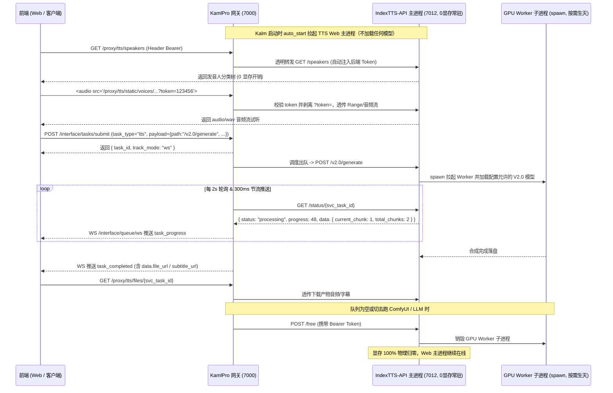

# KamlPro TTS 与全方法透明代理前端接入指南

> 面向前端开发、客户端（Web / PyQt6）与后台运维的完整对接文档。
> 涵盖 **KamlPro 通用透明代理 (`/proxy/{service_name}/...`)**、**IndexTTS-API 轻量化常驻与 GPU Worker 子进程隔离架构**、**TTS V1.5/V2.0 情感控制**、**独立字幕对齐 & JIT 延迟上传**、**参考音试听鉴权**及 **配置调优与故障排查**。

---

## 1. 核心架构与显存隔离原理

### 1.1 为什么采用“常驻 0 显存 Web + 独立 GPU Worker 子进程 + 透明代理”

在单卡环境（如 RTX 4090 24GB，需要同时跑 `ComfyUI` 生图/视频、`Ollama` / `ThinkingCap-27B` 本地大模型与 `IndexTTS-API` 配音/Whisper 字幕）下，传统“按需拉起/强杀 TTS 进程”会导致两个痛点：
1. TTS 空闲关闭期间，前端请求发音人/情绪音列表、管理音色或试听音频会直接 `502`，迫使网关写死专用缓存路由；
2. 单纯在同进程内 `del model` + `torch.cuda.empty_cache()`，PyTorch/CTranslate2 的 CUDA Context 仍会残留数百 MB 显存，切去跑 27B 大模型或 LTX 视频时容易 OOM。

**v1.5.0 架构解法**：
1. **`IndexTTS-API` 侧控制面与算力面分离**：
   - **Web 主进程常驻（`auto_start: true`）**：启动时不导入 `torch`、不初始化 CUDA，**恒定占用 0 MB 显存**，随时秒级响应 `/speaker/*`、`/emo/*`、`/static/*`、`/files/*`、`/download/*`；
   - **GPU 推理隔离进 `spawn` 子进程 Worker**（[inference_worker.py](file:///D:/AIGC/Background_Tasks/IndexTTS-API/app/core/inference_worker.py)）：仅在配置允许且任务到达（或显式预热）时才拉起 Worker 加载对应版本模型；
   - **`POST /free` 显存物理归零**：空闲超时或 KamlPro 调度切换任务调用 `/free` 时，直接销毁 Worker 子进程，由操作系统 **100% 物理回收显存与 CUDA Context**。
2. **`KamlPro` 侧纯透明代理**：
   - 所有非算力接口（查音色、查情绪音、上传/重命名/删除、在线试听、结果下载、模型状态查询）统一走通用透明代理 `/proxy/{service_name}/{path:path}`，**KamlPro 内部不耦合任何 TTS 业务接口**；
   - 耗显存的异步计算任务（TTS 合成、字幕对齐）继续走 `POST /interface/tasks/submit` 进入 FIFO 队列由 [`TaskScheduler`](file:///d:/AIGC/KamlPro/src/core/scheduler.py) 统筹显存切换。

### 1.2 全链路交互时序



---

## 2. 通用全方法透明代理规范 (`/proxy/{service_name}/{path:path}`)

> 源码实现：[file_proxy.py](file:///d:/AIGC/KamlPro/src/api/routes/file_proxy.py) · 鉴权依赖：[require_proxy_token](file:///d:/AIGC/KamlPro/src/core/security.py#L64-L89)

### 2.1 端点定义与服务路由

- **端点**：
  - `ANY /proxy/{service_name}/{path:path}`（Swagger `/docs` 展示常用 `GET / POST / PUT / DELETE` 4 个入口，运行时额外兼容 `HEAD / PATCH`）
  - `ANY /proxy/{service_name}`（转发至后端根路径 `/`；为避免 Swagger UI 出现空路径与参数混淆，默认不在 `/docs` 重复展开）
- **支持 HTTP 方法**：`GET`、`HEAD`、`POST`、`PUT`、`DELETE`、`PATCH`
- **Swagger `/docs` 调试提示**：测试发音人 / 情绪音列表请选 `GET /proxy/{service_name}/{path}`，填入 `service_name=tts`、`path=speakers` 或 `emotions`（同时兼容简写 `emos` 及旧单数路径 `speaker/`、`emo/`）；代理内部已开启 `follow_redirects=True`，会自动处理无末尾斜杠触发的 `307` 重定向。
- **`service_name` 解析规则**：支持传入 `configs/tasks.yaml` 中的任务名（如 `tts`、`comfyui`）或 `configs/services.yaml` 中的服务键名（如 `TTS`、`ComfyUI`），大小写不敏感。
- **向下兼容入口**：`/file/{service_name}/{file_path:path}`（仅限 `GET / HEAD / POST`）与 `/interface/tts/speakers`（带内存缓存）仍保留兼容，新接入统一推荐使用 `/proxy/{service_name}/...`。

### 2.2 鉴权规则与试听方案

网关在 `config.yaml` 中配置 `api_server.tokens` 时：

| 请求方式 / 方法 | `Authorization: Bearer <token>` 请求头 | `?token=<token>` Query 参数 | 说明 |
|---|---|---|---|
| `GET` / `HEAD` | ✅ 支持（推荐） | ✅ **兼容支持**（转发前自动从 URL 剥离） | 专为浏览器原生 `<audio>`、`<video>`、`` 标签直连试听/预览设计 |
| `POST` / `PUT` / `DELETE` / `PATCH` | ✅ **必须** | ❌ 禁止（未带 Header 直接返回 `403`） | 防止写操作凭证在 URL 日志中暴露 |

> **代理透传行为**：
> 1. 自动清洗浏览器的 `Origin`、`Referer`、`Host`、`Sec-Fetch-*`、`Authorization` 等头，按 `configs/services.yaml` 自动注入对应后端服务的 `token`；
> 2. 完整透传其他 Query 参数（如 `?v=1`）、`Range` 请求头，以及响应状态码（含 `206 Partial Content`）与 `Content-Range`、`Accept-Ranges`、`Content-Disposition` 等响应头；
> 3. 下载期间自动调用 `service_controller.download_begin()` / `download_end()` 防止底层服务被意外中断。

---

## 3. 非算力接口调用（全部经 `/proxy/tts/...` 透传）

### 3.1 发音人管理（Speaker）

| 功能 | 方法与路径 | 请求参数 / Body | 响应核心字段 |
|---|---|---|---|
| 获取发音人分类树 | `GET /proxy/tts/speakers`（兼容旧 `GET /proxy/tts/speaker/`） | 无 | `data.categories: [{ name, speakers: [{ name, path }] }]` |
| 新建空分类 | `POST /proxy/tts/speaker/category` | JSON `{"name": "短剧男声"}` | `code: 0, message` |
| 上传发音人音频 | `POST /proxy/tts/speaker/upload` | `multipart/form-data`: `file`, `category`, `name` | 同名全库防冲突校验；支持 `.wav/.mp3/.flac/.ogg/.m4a`（≤300MB） |
| 重命名 / 移动分类 | `PUT /proxy/tts/speaker/rename` | JSON `{"old_path": "voices/ref_audios/常用/a.wav", "new_path": "voices/ref_audios/男声/b.wav"}` | 同名防冲突校验 |
| 删除音频或空分类 | `DELETE /proxy/tts/speaker/` | JSON `{"path": "voices/ref_audios/男声/b.wav"}` | 传目录路径时仅允许删除不含音频的空分类 |

> **小提示**：合成接口里的 `speaker` 参数既可以传完整相对路径 `voices/ref_audios/常用/DV.wav`，也可以直接传短名称 `DV`（后台 `resolve_audio_prompt` 会自动匹配）。

### 3.2 情绪音管理（Emotion，V2.0 参考音频模式用）

| 功能 | 方法与路径 | 请求参数 / Body | 响应核心字段 |
|---|---|---|---|
| 获取情绪音分类树 | `GET /proxy/tts/emotions`（兼容 `/proxy/tts/emos` 与旧 `GET /proxy/tts/emo/`） | 无 | `data.categories: [{ name, emos: [{ name, path }] }]` |
| 新建空情绪分类 | `POST /proxy/tts/emo/category` | JSON `{"name": "激动"}` | `code: 0` |
| 上传情绪音音频 | `POST /proxy/tts/emo/upload` | `multipart/form-data`: `file`, `category`, `name` | 同名防冲突校验 |
| 重命名 / 移动情绪分类 | `PUT /proxy/tts/emo/rename` | JSON `{"old_path": "voices/emo_audios/...", "new_path": "voices/emo_audios/..."}` | `code: 0` |
| 删除情绪音或空分类 | `DELETE /proxy/tts/emo/` | JSON `{"path": "voices/emo_audios/..."}` | `code: 0` |

### 3.3 在线试听（两种前端实现方式）

假设从 `GET /proxy/tts/speakers` 拿到某个音色的 `path` 为 `voices/ref_audios/常用/DV.wav`：

**方式 1：浏览器 `<audio>` 标签直连（最简单，推荐小组件/试听列表）**
```html
<audio controls src="http://127.0.0.1:7000/proxy/tts/static/voices/ref_audios/常用/DV.wav?token=123456"></audio>
```
*(网关会自动校验并剥离 `?token=123456`，转发到下游 `/static/voices/ref_audios/常用/DV.wav`)*

**方式 2：`fetch` + Header Token 转 Blob 缓存播放（Token 不上 URL，推荐对安全要求高的 Web 端）**
```typescript
const audioUrlCache = new Map<string, string>();

async function playVoiceWithAuth(voiceRelPath: string, token: string) {
  let blobUrl = audioUrlCache.get(voiceRelPath);
  if (!blobUrl) {
    const resp = await fetch(`http://127.0.0.1:7000/proxy/tts/static/${voiceRelPath}`, {
      headers: { Authorization: `Bearer ${token}` },
    });
    if (!resp.ok) throw new Error(`试听加载失败: HTTP ${resp.status}`);
    const blob = await resp.blob();
    blobUrl = URL.createObjectURL(blob);
    audioUrlCache.set(voiceRelPath, blobUrl);
  }
  const audio = new Audio(blobUrl);
  await audio.play();
}
```

### 3.4 模型状态查询与按需配置控制

- **查看 Worker 与模型状态**：`GET /proxy/tts/model/status`
  ```json
  {
    "status": "success",
    "code": 0,
    "message": "查询成功",
    "data": {
      "worker_alive": false,
      "worker_pid": null,
      "loaded_version": null,
      "whisper_loaded": false,
      "active_task_id": null,
      "queue_size": 0,
      "enabled_versions": ["V1.5", "V2.0"],
      "preload_version": null,
      "subtitle_enabled": true,
      "unload_after_gen": true,
      "idle_unload_seconds": 15
    }
  }
  ```
- **动态修改策略或手动触发加载/释放**：`POST /proxy/tts/model/config`
  ```json
  {
    "enabled_versions": ["V2.0"],
    "subtitle_enabled": true,
    "idle_unload_seconds": 15,
    "action": "load",
    "version": "V2.0",
    "load_subtitle": false
  }
  ```
  - `action` 可选 `"load"`（按需预热指定 `version` / `load_subtitle`）或 `"unload"`（等同 `POST /proxy/tts/free`，立即销毁 Worker 归零显存）。
  - 若任务队列正忙时请求 `action: "load"`，后端会返回 `409 Conflict`。
- **手动释放显存**：`POST /proxy/tts/free`（正常情况下无需前端手动调用，KamlPro 调度器已在切服务或空闲时自动调用）。

---

## 4. GPU 计算任务接口（走 `/interface/tasks/submit` + 单轨 WS）

> 统一队列与 WebSocket 握手细则请配合阅读 [下游接入契约.md](file:///d:/AIGC/KamlPro/docs/下游接入契约.md)。

### 4.1 TTS 语音合成 (`task_type: "tts"`)

- **端点**：`POST /interface/tasks/submit`（`Content-Type: application/json`）
- **核心请求结构**：
  ```json
  {
    "task_type": "tts",
    "client_id": "client_web_01",
    "payload": {
      "path": "/v2.0/generate",
      "text": "今天天气真不错，咱们去喝杯咖啡吧！",
      "speaker": "DV",
      "generate_subtitle": true
    }
  }
  ```
- **`payload.path` 可选端点**：
  1. `"/v1.5/generate"`（默认，不传 `path` 时走此路径）：V1.5 基础音色克隆，无情感控制，速度较快；
  2. `"/v2.0/generate"`（**推荐对外使用**）：V2.0 纯参数方式，支持 4 种情感控制；
  3. `"/v2.0/emo_mode/generate"`：V2.0 `emotion_mode` 枚举简化模式，带强参数校验。

#### V2.0 情感控制参数说明（优先级：`emo_vector` > `use_emo_text` > `emo_audio_prompt`）

| 情感控制方式 | `/v2.0/generate` 参数 | `/v2.0/emo_mode/generate` 参数 | 说明 |
|---|---|---|---|
| **1. 与发音人原声相同（默认）** | 不传任何情感字段 | `"emotion_mode": "same_as_speaker"` | 完全沿用 `speaker` 参考音频自带的情感 |
| **2. 情感参考音频控制** | `"emotion": "大笑"`（或路径）, `"emo_alpha": 0.8` | `"emotion_mode": "reference_audio"`, `"emotion": "大笑"`, `"emo_alpha": 0.8` | `emo_alpha` 范围 `0.0 ~ 1.0+`，值越大情感越强 |
| **3. 8 维情绪向量控制** | `"emo_vector": [0.7, 0, 0, 0, 0, 0, 0.3, 0]`, `"emo_alpha": 0.9` | `"emotion_mode": "emotion_vector"`, `"emo_vector": [...]`, `"emo_alpha": 0.9` | 向量顺序：`[高兴, 愤怒, 悲伤, 恐惧, 反感, 低落, 惊讶, 自然]` |
| **4. 文本情感驱动** | `"use_emo_text": true`, `"emo_text": "非常激动"(可选)` | `"emotion_mode": "text_driven"`, `"emo_text": "非常激动"(可选)` | 使用 QwenEmotion 提取情绪；不传 `emo_text` 时默认分析 `text` |

**其他常用透传参数**：
- `generate_subtitle` (`bool`, 默认 `false`)：设为 `true` 时同步生成 `.srt` 字幕；
- `interval_silence` (`int`, 默认 `200`, V2.0 有效)：长文本分段合成时段落间的静音毫秒数；
- `max_text_tokens_per_segment` (`int`, 默认 `120`)、`top_k` (`30`)、`top_p` (`0.8`)、`temperature` (V1.5 默认 `1.0` / V2.0 默认 `0.8`)、`repetition_penalty` (`10.0`)、`max_mel_tokens` (V1.5 默认 `600` / V2.0 默认 `1500`)、`use_random` (`bool`)。

> ⚠️ 若请求的模型版本未在 `IndexTTS-API` `config.yaml` 的 `tts.model.enabled_versions` 中启用（或 `subtitle_enabled: false` 时传了 `generate_subtitle: true`），后端会直接返回 `400` 拒绝，任务进入 `failed` 状态且不启动 GPU Worker。

---

### 4.2 独立音频转字幕对齐 (`task_type: "subtitle"`)

针对已有音频 + 文稿，基于 Faster-Whisper 识别并与原文强制对齐生成 `.srt` 字幕：

#### 方式 A：小音频表单直传
```http
POST /interface/tasks/submit
Content-Type: multipart/form-data

task_type: subtitle
client_id: client_web_01
text: 这是需要强制对齐的完整文稿内容。
audio_file: <二进制音频文件 (.wav/.mp3/.flac/.ogg/.m4a)>
output_filename: my_sub.srt   # 可选，默认 subtitle.srt
```

#### 方式 B：大音频 JIT 延迟上传 / 秒传复用（推荐批量分镜场景）
1. 先发轻量 JSON 入队：
   ```json
   {
     "task_type": "subtitle",
     "client_id": "client_web_01",
     "asset_status": "not_ready",
     "required_assets": ["audio_file"],
     "payload": {
       "text": "这是需要强制对齐的完整文稿内容。",
       "output_filename": "my_sub.srt"
     }
   }
   ```
2. 排队轮到该任务时，单轨 WS 收到 `type: "task_asset_required"` 吹哨（含 `upload_url` 与 30s 倒计时）；
3. 前端调用 `POST /interface/tasks/{task_id}/assets` 开闸：
   - 上传本地文件：表单字段名**必须**为 `audio_file`；
   - 免传秒传复用服务端已有音频：传 JSON `{"reuse_assets": {"audio_file": "已存在的文件名.wav"}}`（必须用字典键名 `audio_file` 映射，才能注入 `audio_file_path`）。

---

### 4.3 进度监听、任务取消与产物下载

1. **单轨长连接监听**：`ws://127.0.0.1:7000/interface/queue/ws?client_id=client_web_01`（浏览器传子协议 `["kalm-auth", token]`）
   - 运行期间收到 `task_progress`：
     ```json
     {
       "type": "task_progress",
       "task_id": "8f12d8a0-...",
       "client_id": "client_web_01",
       "progress": 48,
       "message": "正在合成文本分段 (1/2)"
     }
     ```
   - 完成后收到 `task_completed`（`status: "success"`）：
     ```json
     {
       "type": "task_completed",
       "task_id": "8f12d8a0-...",
       "task_type": "tts",
       "client_id": "client_web_01",
       "status": "success",
       "result": {
         "status": "completed",
         "message": "生成完成",
         "progress": 100,
         "data": {
           "task_id": "<svc_task_id>",
           "progress": 100,
           "download_url": "/download/<svc_task_id>",
           "file_url": "/files/<svc_task_id>",
           "subtitle_url": "/download/subtitle/<svc_task_id>"
         }
       }
     }
     ```
2. **下载产物（统一走 `/proxy/tts/...`）**：

| 产物 | 推荐请求地址 | 说明 |
|---|---|---|
| 合成音频（可多次下载/重试） | `GET /proxy/tts{result.data.file_url}`<br>即 `/proxy/tts/files/{svc_task_id}` | 不删除源文件，支持多次读取（受后台 `retention_hours` 清理周期管理） |
| 合成音频（阅后即焚流） | `GET /proxy/tts{result.data.download_url}` | 后台 `delete_after_stream: true` 时下载 1 次后自动删除 |
| 字幕 SRT（阅后即焚流） | `GET /proxy/tts{result.data.subtitle_url}` | 后台 `delete_after_stream: true` 时下载 1 次后自动删除 |
| 字幕 SRT（可重复读取） | TTS 同步字幕：`/proxy/tts/static/{svc_task_id}/{svc_task_id}.srt`<br>独立字幕任务：`/proxy/tts/static/{svc_task_id}/{output_filename}` | 走静态路由，不触发阅后即焚 |

3. **中途取消任务**：`POST /interface/tasks/{task_id}/cancel`
   - 排队中：从 KamlPro 队列移出并通知 `IndexTTS-API` 标记取消；
   - 执行中：KamlPro 终止本地轮询并通知 `IndexTTS-API` `POST /cancel/{svc_task_id}`，后台立即销毁 GPU Worker 子进程停止计算并释放显存。

---

## 5. 前端完整接入示例（TypeScript）

```typescript
const BASE_URL = "http://127.0.0.1:7000";
const TOKEN = "123456";
const CLIENT_ID = "web_client_demo";

// 1. 建立全局单轨 WS
const ws = new WebSocket(
  `ws://127.0.0.1:7000/interface/queue/ws?client_id=${CLIENT_ID}`,
  ["kalm-auth", TOKEN]
);

setInterval(() => {
  if (ws.readyState === WebSocket.OPEN) ws.send("ping");
}, 30000);

ws.onmessage = async (event) => {
  if (event.data === "pong") return;
  const msg = JSON.parse(event.data);

  if (msg.type === "task_progress") {
    console.log(`[进度 ${msg.task_id}] ${msg.progress}% - ${msg.message}`);
  } else if (msg.type === "task_completed" && msg.status === "success") {
    const d = msg.result?.data || {};
    if (d.file_url) {
      // 播放或下载音频
      const audioUrl = `${BASE_URL}/proxy/tts${d.file_url}?token=${TOKEN}`;
      console.log("音频可用地址:", audioUrl);
    }
    if (d.subtitle_url) {
      const srtResp = await fetch(`${BASE_URL}/proxy/tts${d.subtitle_url}`, {
        headers: { Authorization: `Bearer ${TOKEN}` },
      });
      console.log("SRT 字幕内容:\n", await srtResp.text());
    }
  }
};

// 2. 通过透明代理拉取发音人与情绪音（0 显存开销）
async function loadVoiceAssets() {
  const headers = { Authorization: `Bearer ${TOKEN}` };
  const [spkRes, emoRes] = await Promise.all([
    fetch(`${BASE_URL}/proxy/tts/speakers`, { headers }).then((r) => r.json()),
    fetch(`${BASE_URL}/proxy/tts/emotions`, { headers }).then((r) => r.json()),
  ]);
  return { speakers: spkRes.data.categories, emotions: emoRes.data.categories };
}

// 3. 提交 V2.0 配音 + 同步字幕任务
async function submitTTS(text: string, speaker: string) {
  const resp = await fetch(`${BASE_URL}/interface/tasks/submit`, {
    method: "POST",
    headers: {
      Authorization: `Bearer ${TOKEN}`,
      "Content-Type": "application/json",
    },
    body: JSON.stringify({
      task_type: "tts",
      client_id: CLIENT_ID,
      payload: {
        path: "/v2.0/generate",
        text,
        speaker,
        emo_vector: [0.7, 0.0, 0.0, 0.0, 0.0, 0.0, 0.3, 0.0],
        emo_alpha: 0.85,
        generate_subtitle: true,
      },
    }),
  });
  return resp.json();
}
```

---

## 6. 服务端配置与常见问题排查

### 6.1 关键配置清单

1. **KamlPro [configs/services.yaml](file:///d:/AIGC/KamlPro/configs/services.yaml#L117-L129)**：
   ```yaml
   TTS:
     enabled: true
     auto_start: true                 # 常驻 Web 主进程（0 显存）
     host: "http://127.0.0.1"
     port: 7012
     token: "123456"
     ready_keyword: "started"
     manage_lifecycle: true
     free_api:
       path: "/free"
       body:
         unload_models: true
         free_memory: true
   ```
2. **IndexTTS-API [config.yaml](file:///D:/AIGC/Background_Tasks/IndexTTS-API/config.yaml#L49-L63)**：
   ```yaml
   tts:
     model:
       enabled_versions: ["V1.5", "V2.0"]  # 设 [] 则完全禁止加载 TTS 模型
       preload_version: null               # null = 启动不加载任何模型（0 显存）
       subtitle_enabled: true              # 是否允许按需加载 Whisper
       idle_unload_seconds: 15             # 队列空闲自动回收秒数（0 表示仅由 /free 释放）
       runtime_settings:
         unload_after_gen: true
   ```

### 6.2 常见状态码与排查

| 状态码 | 可能原因 | 处理方式 |
|---|---|---|
| `400` | 提交了未在 `enabled_versions` 启用的版本、`subtitle_enabled: false` 时请求字幕、或 `speaker` / `emotion` 参考音文件不存在 | 检查 `GET /proxy/tts/model/status` 与 `GET /proxy/tts/speakers` |
| `401` / `403` | Token 错误或缺失；或写操作（`POST/PUT/DELETE/PATCH`）把 Token 放进了 `?token=` 而未放在 Header | 所有写操作与接口请求均使用 `Authorization: Bearer <token>` |
| `409` | 队列有活跃/排队任务时调用 `/proxy/tts/model/config` 且带了 `action: "load"` | 等任务完成后再调用预热 |
| `410` | 通过 `/download/{id}` 重复下载了同一文件（已被 `delete_after_stream: true` 删除）或文件已过 `retention_hours` 清理期 | 多次下载请使用 `/proxy/tts/files/{svc_task_id}` 与 `/proxy/tts/static/{svc_task_id}/...` |
| `502` | `TTS` 服务未启动或已退出（如未设 `auto_start: true` 或被外部手动关闭） | 确认 [configs/services.yaml](file:///d:/AIGC/KamlPro/configs/services.yaml#L117-L129) `TTS.auto_start: true` 并重启 KamlPro |
| `503` | `TTS` 在 `services.yaml` 中被设为 `enabled: false` | 按需开启 `enabled: true` |

