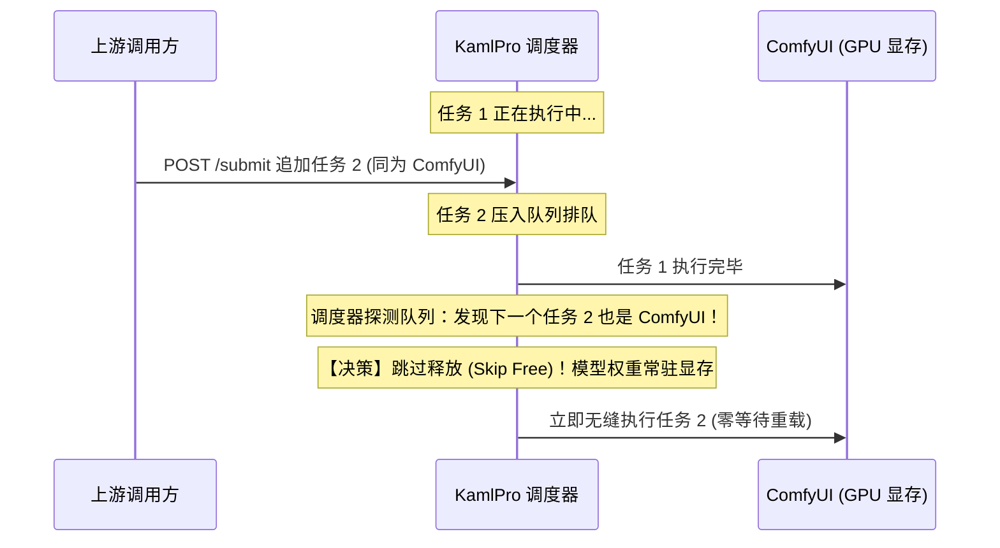
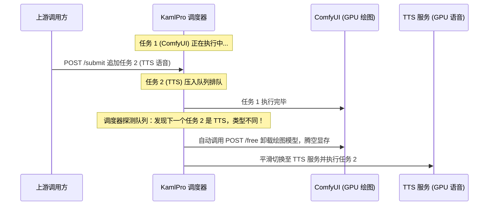

# KamlPro 任务队列机制与资源调度接入交付指南

> **面向对象**：上游业务系统架构师、前端与客户端开发团队、算法集成团队。  
> **适用版本**：KamlPro (Kalm) 全平台网关  
> **核心原则**：**透明代理 + 智能排队调度 + 显存无感自动释放**。

---

## 1. 架构定位与设计哲学

在多模态 AIGC 生产流程中（涵盖 ComfyUI 图像/视频生成、IndexTTS 语音合成、Whisper 字幕生成、以及本地/云端 LLM 推理），单台宿主机往往配备有限的高性能 GPU（如单张 RTX 4090 / A100）。

如果上游业务直接并发请求底层推理进程，势必导致显存溢出（OOM）崩溃或严重的 GPU 算力竞争。KamlPro 作为统一控制网关，提供以下核心价值：

```
[ 上游业务端 / 前端 / 编排系统 ]
              │ (HTTP / WebSocket)
              ▼
    ┌──────────────────────┐
    │  KamlPro 调度网关    │
    │  - 双轨异步调度       │
    │  - 显存动态探测与回收  │
    └──────────┬───────────┘
               │ (按需排队 / 进程生命周期托管 / free_api)
        ┌──────┴────────────────────────┐
        ▼                               ▼
 [ 本地 GPU 串行队列 ]           [ 云端 API 并发线程池 ]
 - ComfyUI (绘图/视频)           - DeepSeek / OpenAI / Claude
 - IndexTTS (语音合成)           - 并发请求池 + 忙闲自适应
 - Ollama (本地大模型)
```

1. **本地 GPU 串行轨道**：单任务独占 GPU 推理，严格基于 FIFO 队列排队，杜绝显存踩踏。
2. **云端 API 并发轨道**：基于并发线程池调度，支持流式直连（Stream）与排队等待自适应切换。
3. **资源全自动闭环**：任务执行完后的显存释放完全由网关自动决策驱动，**上游无需手动调用任何清理接口**。

---

## 2. 调度器显存释放机制（`free_api` 原理）

### 2.1 运行机制总览

为防止本地模型长期空置霸占显存，KamlPro 引入了基于 `configs/services.yaml` 的 `free_api` 资源释放机制（目前 ComfyUI 默认开启）。

在每个任务执行完毕后，调度器会自动执行以下决策树：

```mermaid
graph TD
    A[当前任务执行完毕] --> B{调度器探测队列中的下一个任务<br/>_peek_next_task_type}
    B -->|下一个任务与当前同类型<br/>例如: ComfyUI -> ComfyUI| C[跳过释放 (Skip Free)<br/>保持模型常驻显存，极速复用]
    B -->|下一个任务为不同类型<br/>例如: ComfyUI -> TTS| D[触发 free_api 显存释放<br/>卸载当前模型，为下一服务腾出显存]
    B -->|队列为空<br/>暂无后续任务| E[触发 free_api 显存释放<br/>回收显存，归还系统与其他应用]
```

### 2.2 底层释放动作剖析

当调度器决定释放资源时：
1. 调度器从 `configs/services.yaml` 读取当前服务的 `free_api` 配置（以 ComfyUI 为例）：
   ```yaml
   free_api:
     path: "/free"
     body:
       unload_models: true   # 卸载模型权重 (UNet, CLIP, VAE 等)
       free_memory: true     # 执行 torch.cuda.empty_cache() 回收显存
   ```
2. 调度器发起 `POST http://127.0.0.1:7011/free`。
3. 调度器自动通过 `nvidia-smi` 记录显存变化并输出日志：
   `[Scheduler] Freed resources for ComfyUI | GPU: 18450MiB -> 1250MiB`。

> 📌 **重要结论**：
> - 上游厂商**不需要、也不应主动调用**显存释放接口。
> - 网关保证“需要用时自动拉起/加载，空闲或换乘时自动清理”。

---

## 3. 动态任务追加与混合排队调度机制

### 3.1 是否支持随时追加任务？
**完全支持，且此机制是 KamlPro 调度的核心原生能力。**

上游调用方无需等待前序任务完成，可在**任意时刻**调用 `POST /interface/tasks/submit` 追加新任务。无论是任务 1 正在排队，还是任务 1 正在 GPU 上全速计算，任务 2 都会毫秒级压入底层的线程安全 FIFO 任务队列中。

---

### 3.2 两种追加场景与调度器行为剖析

针对追加的任务与正在运行的任务，系统分为以下两种核心场景自适应调度：

#### 场景 A：同类型任务追加（如 1 是 ComfyUI，2 也是 ComfyUI）
* **调度逻辑**：
  1. 任务 1 正在 GPU 上执行；上游追加任务 2 进入队列。
  2. 任务 1 执行完毕瞬间，调度器调用 `_peek_next_task_type()` 窥探队列首部，检测到下一个任务 2 **同为 comfyui**。
  3. **命中优化**：调度器**跳过释放 (`skip free`)**，大模型权重（Checkpoint / LoRA / VAE）完整保留在显存中。
  4. 调度器直接复用活跃服务，无缝开跑任务 2。
* **业务收益**：**零冷启动开销**，避免了重复从磁盘加载数十 GB 模型权重的漫长等待，整体流水线吞吐率提升 40%~70%。



---

#### 场景 B：不同类型任务追加（如 1 是 ComfyUI 绘图，2 是 TTS 语音 或 本地 LLM）
* **调度逻辑**：
  1. 任务 1（ComfyUI）正在执行；上游追加任务 2（TTS）进入队列。
  2. 任务 1 执行完毕瞬间，调度器窥探到下一个任务 2 是 `tts`，与当前任务类型**不一致**。
  3. **智能避让**：调度器自动触发 `_free_service_resources('ComfyUI')`，调用 ComfyUI 的 `POST /free` 卸载绘图模型并清空 CUDA 缓存，将显存完整归还。
  4. 调度器平滑切换到 TTS 语音服务并拉起执行任务 2。
* **业务收益**：**多服务安全交接**。在有限的单张消费级/企业级显卡上，实现多种异构 AI 服务的无缝串联调度，彻底杜绝多模型并发导致的显存溢出（CUDA OOM）崩溃。



---

### 3.3 提交模式对比总结

| 提交方式 | 队列状态 | 调度器行为 | 适用场景 |
|---|---|---|---|
| **连续批量/动态追加（同类型）** | 始终有后继任务 | 跳过释放，模型持续常驻 | 批量出图、批量视频生成 |
| **混合异构追加（不同类型）** | 发现类型切换 | 自动清理旧显存，拉起新服务 | 绘图后配音一条龙业务流 |
| **单任务串行（等前一个完全结束后再提）** | 任务完成时队列为空 | 自动触发释放，下次重载模型 | 低频散客请求、单次测试 |


---

## 4. 接入协议与交互通道规范

上游厂商与 KamlPro 交互，推荐采用 **“HTTP 批量提交 + WS 队列广播总线 + WS 单任务进度”** 经典组合架构。

```
           1. 批量提交任务 (POST /interface/tasks/submit)
上游端 ─────────────────────────────────────────────────────────► KamlPro
       ◄─────────────────────────────────────────────────────────
           返回: task_id, status: "queued", track_mode: "ws"

           2. 建立队列常驻监听 (WS /interface/queue/ws)
上游端 ◄═════════════════════════════════════════════════════════ KamlPro
           接收: task_enqueued / task_started / task_completed

           3. (可选) 绑定单任务实时进度 (WS /interface/tasks/{id}/ws)
上游端 ◄═════════════════════════════════════════════════════════ KamlPro
           接收: overall_progress (0~99% 平滑单调递增)

           4. 任务完成后拉取最终产物 (GET /interface/tasks/{id}/status)
上游端 ─────────────────────────────────────────────────────────► KamlPro
```

### 4.1 任务提交接口

- **端点**：`POST /interface/tasks/submit`
- **请求体 (以 ComfyUI 为例)**：
  ```json
  {
    "task_type": "comfyui",
    "payload": {
      "prompt": { /* ComfyUI 原生工作流 Prompt 字典 */ },
      "final_output_node_id": "9"
    }
  }
  ```
- **响应体**：
  ```json
  {
    "status": "success",
    "message": "ok",
    "data": {
      "task_id": "8b9e671c-3e61-464a-a1da-c70e0b3c6628",
      "status": "queued",
      "track_mode": "ws",
      "hint": "Connect to ws://host:port/interface/tasks/8b9e671c-3e61-464a-a1da-c70e0b3c6628/ws for real-time progress"
    }
  }
  ```

### 4.2 队列广播总线（`/interface/queue/ws`）

建议上游前端或调度端保持**单条长连接**，管理当前所有任务的流转：

- **心跳机制**：客户端每 30 秒发送文本 `"ping"`，服务端返回 `"pong"`。
- **广播消息类型**：

| 消息类型 (`type`) | 触发时机 | 携带字段 | 上游推荐动作 |
|:---|:---|:---|:---|
| `task_enqueued` | 任务成功排入队列 | `task_id`, `task_type`, `track_mode` | 更新上游 UI 状态为“排队中” |
| `task_started` | 任务被调度器取出发起执行 | `task_id`, `task_type`, `track_mode` | 更新 UI 为“执行中”，如需看细粒度进度可连任务 WS |
| `task_completed` | 任务执行完毕 | `task_id`, `next_task_id`, `next_task_type` | 调用 `GET /status` 获取最终文件 URL / 结果 |
| `task_failed` | 任务因错误或取消中断 | `task_id`, `message` | 标记任务失败并提示错误信息 |

### 4.3 单任务平滑进度监听（`/interface/tasks/{id}/ws`）

如果上游需要向最终用户展示百分比进度条：
- 监听消息中 `type === "overall_progress"`。
- KamlPro 已内置智能进度拦截器，解决了 ComfyUI 底层多节点百分比横跳与倒退的问题，提供 **0% ~ 99% 严格单调递增** 的完美商业级体验。

### 4.4 任务主动取消与中断接口

- **端点**：`POST /interface/tasks/{task_id}/cancel`
- **机制**：
  - 若任务处于 `queued` 排队中，立即从队列移除并标记失败。
  - 若任务处于 `running` 执行中，网关同时向底层引擎（如 ComfyUI `/interrupt` 及 `/queue`）下发物理中断信号，及时中止模型运算，节约显存与算力。

---

## 5. 上游接入典型场景与代码范式

### 场景：批量生成多张图片（Node.js / 浏览器 JS 示例）

```javascript
// 1. 全局监听队列 WebSocket
const queueWs = new WebSocket("ws://127.0.0.1:7000/interface/queue/ws");
const myPendingTasks = new Set();

queueWs.onmessage = (event) => {
  const msg = JSON.parse(event.data);
  if (!myPendingTasks.has(msg.task_id)) return; // 过滤非我方任务

  if (msg.type === "task_started") {
    console.log(`[队列通知] 任务 ${msg.task_id} 开始执行`);
  } else if (msg.type === "task_completed") {
    console.log(`[队列通知] 任务 ${msg.task_id} 执行完成，拉取结果...`);
    fetchTaskResult(msg.task_id);
    myPendingTasks.delete(msg.task_id);
  } else if (msg.type === "task_failed") {
    console.error(`[队列通知] 任务 ${msg.task_id} 失败: ${msg.message}`);
    myPendingTasks.delete(msg.task_id);
  }
};

// 2. 批量提交任务（一次性推入队列，享受模型常驻收益）
async function batchSubmitImageTasks(workflows) {
  for (const wf of workflows) {
    const res = await fetch("http://127.0.0.1:7000/interface/tasks/submit", {
      method: "POST",
      headers: { "Content-Type": "application/json" },
      body: JSON.stringify({
        task_type: "comfyui",
        payload: { prompt: wf }
      })
    });
    const result = await res.json();
    if (result.status === "success") {
      const taskId = result.data.task_id;
      myPendingTasks.add(taskId);
      console.log(`[入队成功] 任务已入队: ${taskId}`);
    }
  }
}

// 3. 拉取产物
async function fetchTaskResult(taskId) {
  const res = await fetch(`http://127.0.0.1:7000/interface/tasks/${taskId}/status`);
  const data = await res.json();
  console.log("产物下载地址:", data.data.result.outputs);
}
```

---

## 6. 常见问题排查与 FAQ

### Q1: 为什么有时候连续执行任务，第一张图耗时正常，第二张图又变慢了？
> **排查**：请确认上游是否是“等第一张完全下载处理好，才提交第二张”。如果是这样，第一张完成时队列处于空闲状态，调度器自动触发了 `free_api` 释放显存。建议提前将待生成任务连续批量入队。

### Q2: 上游需要为 TTS / 字幕任务配置 `free_api` 吗？
> **答**：不需要。TTS 与字幕服务显存占用较小且模型加载极快，默认无需配置 `free_api`；调度器会自动识别并跳过无 `free_api` 配置的服务。

### Q3: 任务如果超时或异常，网关会卡死后续队列吗？
> **答**：不会。调度器设置了进程就绪超时（`startup_timeout`）和任务执行异常捕获。遇到错误时会自动清理当前任务、标记为 `failed`、广播 `task_completed` 并拉起后续排队任务。
